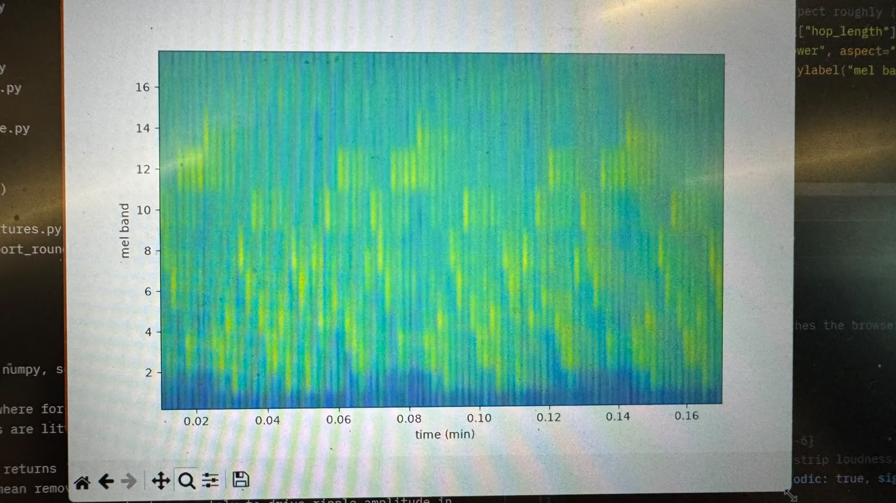

# The Inspo
I've always wanted to make an audio visualizer - since my VLC media player days. But it would always get watered down by other plans and commitments. I finally sat down to do it, my way.

In fall 2025, I took Intelligent Systems with Professor Ali Minai, and one concept that stuck with me for a while was the Self Organized Feature Map (SOFM). In simple terms, a SOFM is a way for a computer to learn to recognize patterns in a big pile of complicated data, without anyone telling it the right answers. It works a bit like arranging items on a table so that similar things end up close together and different things end up far apart. Over time, the map “organizes itself,” so you can look at it and see the natural groupings and patterns the computer found in the data.

It's like how it 'understands' patterns from a mess you give it.

With that in mind, I asked myself the question one day - "Damn, this song sounds good. How could my computer ever understand the parts of my brain this tickles?".

I had a eureka moment. The SOFM!! So how does this frankenstein work?

# The Process

I used the FFT to split each short slice of audio into frequency bins, then grouped those bins into 48 mel bands that follow how we hear pitch. Each slice becomes one 48-number fingerprint of its spectral shape.

(look at that, isn't that so f'ing cool? gotta love fft)

Next I trained a 24x24 self-organizing map on about 56,000 of these fingerprints, taken from 5 songs of roughly three minutes each. The map learns to arrange similar-sounding frames near each other: each neuron stores a typical spectral shape, and neighbors store similar ones.

After training I froze the weights. At runtime, audio is cut into overlapping 46 ms frames, one every 23 ms (about 43 per second). Each frame is converted to a fingerprint, and the closest neuron lights up. A wave simulation on the grid turns changes in sound into ripples. You can upload a song, capture another tab’s audio, or use your microphone.

# ASCII?

This was purely a design choice. I love ascii, and it makes it feel like a computer is trying to talk to me with what's available to it, so teehee.

# The Final Product!

And that's where we are today! My frankenstein of an audio visualizer that somehow squeezed an ML model into it. Yay!

Try it out [here](https://sofm-dfft-ascii-visualizer-production.up.railway.app)
