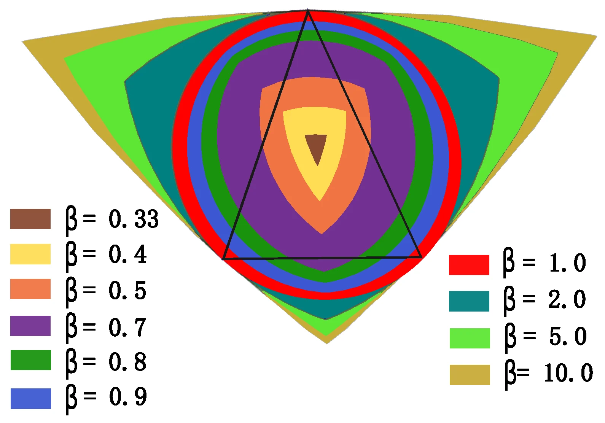

I worked on this paper with [Dr. Philip Wilsey](https://www.linkedin.com/in/philipwilsey/) and [Dr. Rohit Pal](https://www.linkedin.com/in/rohit-pal-singh-794a6923/) in UC's Experimental Computing Lab as an Undergraduate Research Assistant. 

The problem we were trying to solve was the space and time complex existing algorithms had with regards to extracting features from data/point clouds in higher dimensions, like r^15+

I specifically worked on performance testing and optimization with 

Link to paper - https://doi.org/10.3390/math14081339
